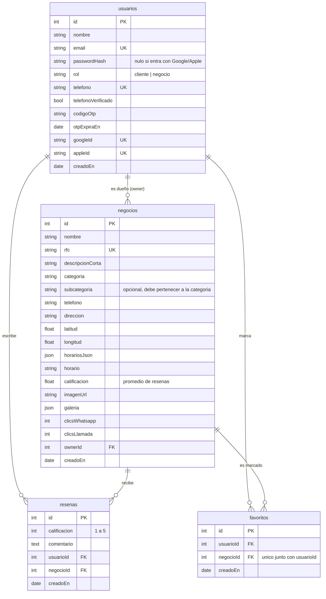

# Base de datos

TypeORM crea las tablas solas (`synchronize: true`, solo para desarrollo). La fuente de verdad son los `*.entity.ts` en `backend/src/modules/`.

Al borrar un usuario o negocio se borran en cascada sus reseñas y favoritos; si se borra el dueño de un negocio, `ownerId` queda nulo.
