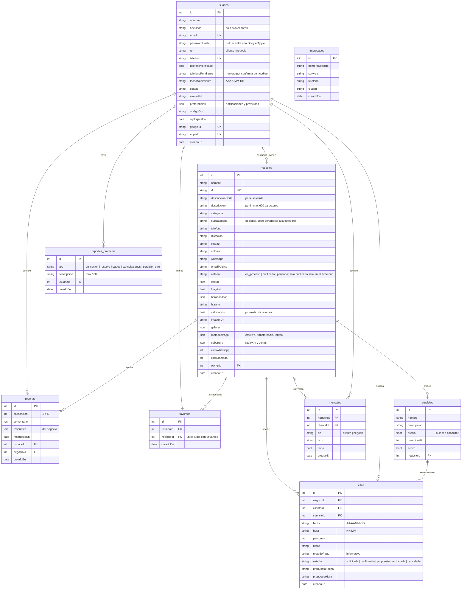

# Base de datos

TypeORM crea las tablas solas (`synchronize: true`, solo para desarrollo). La fuente de verdad son los `*.entity.ts` en `backend/src/modules/`.

`interesados` guarda los contactos del formulario "Únete gratis" de la landing (sin cuenta, sin relaciones).

Las tablas del portal del proveedor que faltan (servicios, solicitudes y citas, mensajes, notificaciones, disponibilidad, formas de pago) están descritas por sus datos en [`api-portal-proveedor.md`](api-portal-proveedor.md).

Al borrar un usuario o negocio se borran en cascada sus reseñas y favoritos; si se borra el dueño de un negocio, `ownerId` queda nulo.
